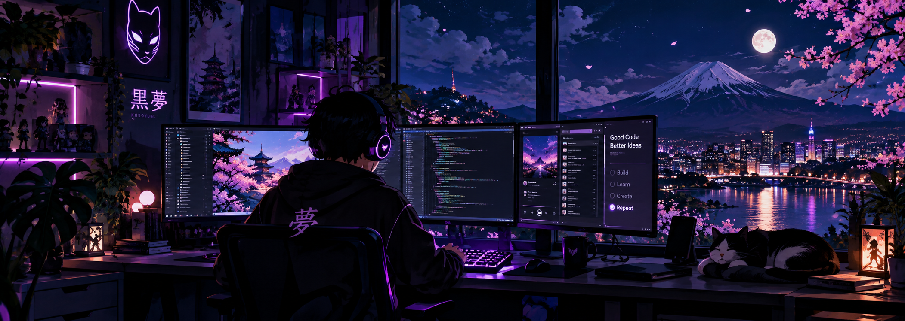
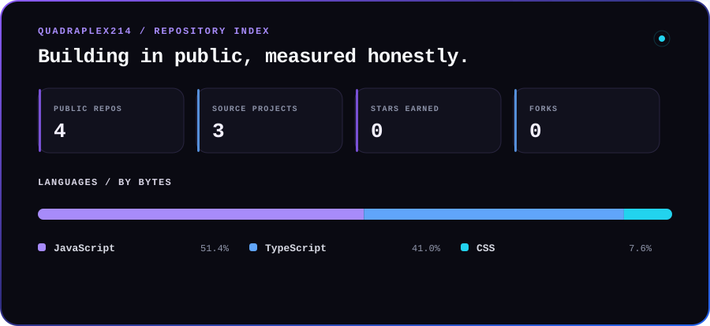

  

<h1 align="center">Joshua · Software Developer</h1>

  I build modern web products, API-driven experiences, and engineering automation.

  <code>BUILD</code>&nbsp;&nbsp;·&nbsp;&nbsp;<code>LEARN</code>&nbsp;&nbsp;·&nbsp;&nbsp;<code>CREATE</code>&nbsp;&nbsp;·&nbsp;&nbsp;<code>REPEAT</code>

## About

I’m a software developer focused on turning ideas into usable products. My public work currently centers on the Next.js ecosystem: thoughtful interfaces, third-party API integrations, browser-based data, and the automation needed to keep projects reliable.

I care about the full product surface—from interaction design and responsive layouts to caching, testing, and delivery.

## Featured work

### [Kuroyume](https://github.com/Quadraplex214/kuroyume)

**A personal story atlas for discovering anime, manga, and manhwa.**

Kuroyume brings discovery, seasonal browsing, recommendations, title comparison, and a private on-device library into one polished experience. Libraries support ratings, progress, favorites, notes, collections, and JSON import/export without requiring an account.

`Next.js 16` · `React 19` · `TypeScript` · `Tailwind CSS` · `Vitest` · `Playwright`

- Integrates MyAnimeList data through RapidAPI with Jikan enrichment.
- Uses bounded caching, request deduplication, pacing, and upstream rate-limit cooldowns.
- Covers catalog logic, library behavior, navigation, reloads, hydration, and mobile overflow in CI.

**[View live project ↗](https://kuroyume.vercel.app)** &nbsp;·&nbsp; **[Explore source →](https://github.com/Quadraplex214/kuroyume)**

---

### [German Hospitality Web Experience](https://github.com/Quadraplex214/german-website-for-translation)

**A responsive, multi-page hospitality concept with localization built into the experience.**

The project combines a broad content structure with browser-side language switching, motion-driven components, theme handling, and responsive navigation across dining, events, reservations, and editorial pages.

`Next.js 15` · `React 19` · `TypeScript` · `JavaScript` · `Tailwind CSS` · `Framer Motion`

**[View live project ↗](https://web-german-translate.vercel.app)** &nbsp;·&nbsp; **[Explore source →](https://github.com/Quadraplex214/german-website-for-translation)**

## Technology

**Product engineering**  
Next.js · React · TypeScript · JavaScript · Tailwind CSS

**Testing & automation**  
Playwright · Vitest · Testing Library · Python · GitHub Actions

**APIs & delivery**  
REST APIs · Git · GitHub · Vercel · GitHub Pages

**Currently exploring**  
Rust · Tauri · developer tooling · deeper API and automation workflows

## 📊 Repository Statistics

  

Calculated from public GitHub API data. Language share uses repository language bytes—not primary-language counts—and excludes forks, archived repositories, empty repositories, and this profile repository.

## Current direction

I’m interested in products where interface quality and engineering quality reinforce each other: useful web applications, well-behaved API integrations, reliable automation, and tools that remove repetitive work.

**[Browse all repositories →](https://github.com/Quadraplex214?tab=repositories)**
